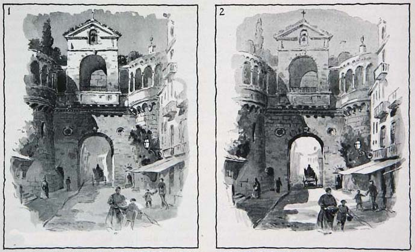
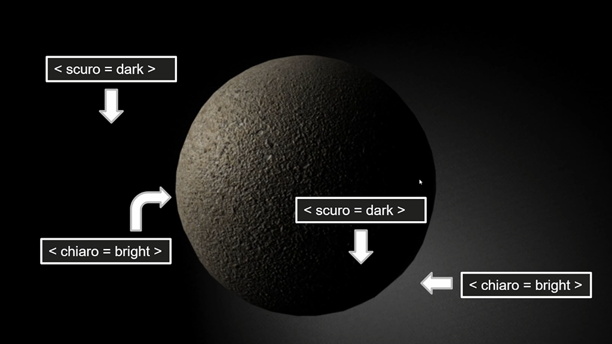
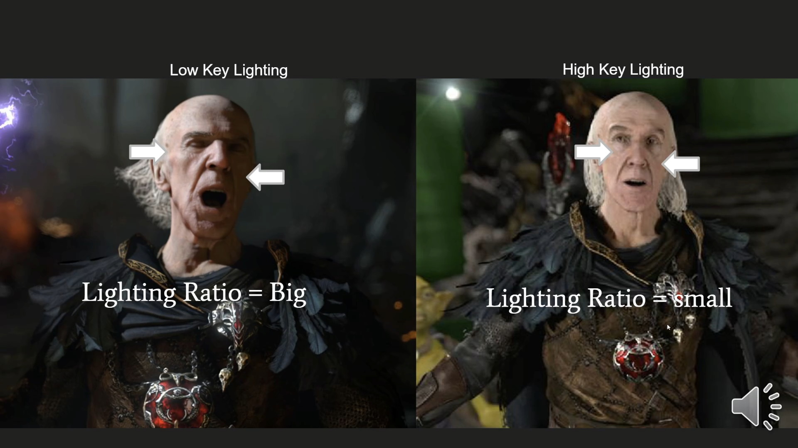
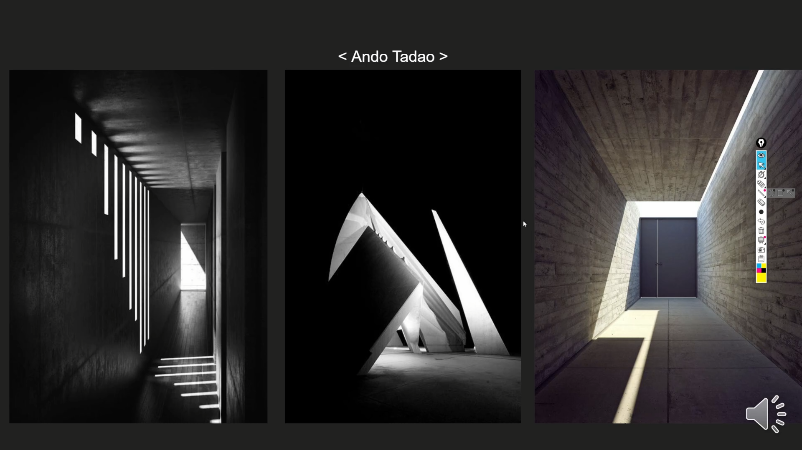

# 레벨 디자인에서의 라이팅 1
## 오리엔테이션: 레벨 디자인의 관점에서 라이팅 해부하기

빛은 공간에서 무슨 일을 하는가, 그리고 레벨 디자이너는 그 빛을 어떻게 다뤄야 하는가

발표자: Sungkuk Park (RenderBrains) · 대상: 레벨 디자이너

---
layout: two-cols
layoutClass: gap-8
---

# 이 강의의 관점

- 라이팅 아티스트가 아니라 **레벨 디자이너의 눈**으로 빛을 본다
- 질문은 하나: *이 빛은 플레이어의 경험에 무슨 일을 하는가?*
- 오늘은 엔진을 열지 않는다. 툴보다 **원리**가 먼저다
- 발표자도 라이팅 전문가가 아니다. 개념을 먼저 공부한 사람으로서 지도를 공유한다
- 목표: "이런 개념이 있다"는 지도를 머릿속에 그리는 것

::right::

# 강의 로드맵

1. **오리엔테이션** — 라이팅 해부하기 (오늘)
2. **프로젝트 세팅** — UE 5.8.4 디폴트 세팅 13종
3. **EV(노출) 세팅** — 빛의 "양"을 숫자로 다루기

오늘 그린 지도 위에, 2·3강에서 엔진의 실제 값을 채워 넣는다.

---

# 해부 1: 레벨 디자인에서 라이팅이 하는 일

1. **시각적 유도** (Visual Guidance) — 플레이어를 어디로 보게 하고 어디로 가게 할 것인가
2. **정서적 분위기 조성** (Mood & Emotion) — 이 공간에서 무엇을 느끼게 할 것인가
3. **가독성과 게임플레이 정보 전달** (Readability & Gameplay Communication) — 무엇을 보고 판단하게 할 것인가

이어지는 슬라이드는 이 세 가지를 하나씩 해부하고, 그다음 이 일을 해내는 도구(광원)를 해부한다.

---

# 시각적 유도의 사례 1: 포컬 포인트(Focal Point)

- 밝기·색·대비로 플레이어의 시선을 한 지점에 모은다
- 원칙: **가장 밝고 대비가 큰 곳 = 플레이어가 가야 할 곳**
- 예: 어두운 방에서 빛이 새어 나오는 출구, 멀리 조명된 랜드마크
- 사례: *Half-Life 2*, *The Last of Us*의 길 안내 조명
- 주의: 포컬 포인트가 여러 개면 시선이 분산된다

---

# 포컬 포인트의 사례

참조: <a href="https://gurneyjourney.blogspot.com/2009/05/tonal-focus.html" target="_blank" rel="noopener">Gurney Journey — Tonal Focus</a>

---

# 시각적 유도의 사례 2: 키아로스쿠로(Chiaroscuro)

- 이탈리아어 *chiaro*(밝음) + *oscuro*(어둠): 강한 명암 대비 기법
- 르네상스·바로크 회화(카라바조, 렘브란트)에서 유래
- 게임에서는: 실루엣과 형태 강조, 보이는 정보 제한, 긴장감·미스터리 조성
- 사례: *Thief*, *Dishonored*, *Inside*

참조: <a href="https://youtu.be/NzCXVfzQ-EI" target="_blank" rel="noopener">키아로스쿠로 해설 영상 (YouTube)</a>

---

# 키아로스쿠로의 사례

---

# 정서적 분위기 조성(Mood)

- 색온도: 따뜻한 빛 = 안전·휴식, 차가운 빛 = 위협·고립
- 키(Key): 하이키(밝고 평탄함) vs 로우키(어둡고 대비가 강함)
- 그림자의 양: 그림자가 많을수록 불확실성과 공포가 커진다
- 빛의 움직임: 깜빡임·흔들림 = 불안, 일정한 빛 = 안정
- 동선 안에서 안전 구역과 위험 구역을 빛으로 대비시킨다

---

# 정서적 분위기 조성의 사례

- 세이브 룸 · 휴식 공간: 따뜻하고 일정한 빛으로 "여기는 안전하다"를 전달 (예: *Resident Evil* 시리즈의 세이브 룸)
- 공포 구간: 로우키 + 차가운 색 + 깜빡이는 조명으로 긴장을 끌어올림
- 같은 공간을 빛만 바꿔서 연출: 낮에 지나온 마을을 밤에 다시 지날 때 전혀 다른 감정을 준다

---

# 로우키와 하이키 라이팅의 사례

---

# 가독성과 게임플레이 정보 전달(Readability)

- 플레이어가 **보고, 판단하고, 행동할 수 있게** 하는 것이 먼저다
- 실루엣 분리: 캐릭터·적·발판의 명도를 배경과 다르게 둔다
- 상호작용 대상 강조: 림 라이트, 발광(Emissive) 소재로 "만질 수 있는 것"을 표시
- 색의 약속: 빨간 빛 = 위험, 초록/파란 빛 = 안전·진행 가능처럼 규칙을 일관되게 유지
- 주의: 분위기를 위해 전투 공간을 너무 어둡게 만들면 판독이 불가능해진다

---

# 가독성과 게임플레이 정보 전달의 사례

- 스텔스 게임: 빛과 그림자 자체가 **게임 규칙** (예: *Thief*, *Splinter Cell*의 라이트 미터)
- 플랫포머: 밟을 수 있는 발판만 밝게 조명해 경로를 읽게 한다
- 전투 아레나: 엄폐물과 적 스폰 지점을 조명으로 미리 보여 준다

<b>Question</b> — 아무리 레벨 디자인을 잘했어도 내가 의도한 위치가 보이지 않거나 너무 어둡다면? 아니면 내가 의도한 부분이 아니라 다른 부분이 라이팅에 의해서 더 부각된다면?

---

# Call of Duty: Modern Warfare (2019)

"Clean House" 미션 — 세 가지 일(유도·분위기·가독성)이 한 레벨 안에서 어떻게 맞물리는지 보자

<a href="https://youtu.be/KurHR-5VmIw" target="_blank" rel="noopener">"Clean House" 미션 플레이 영상 보기 (YouTube)</a>

---

# 해부 2: 게임 라이팅의 기본 구성 요소(Fundamentals)

|                           | 전역(Global), 전방위적 영향 | 지역(Local), 국소적 영향 |
| ------------------------- | -------------------------- | ---------------------------- |
| 한 방향을 밝힘    | **Directional light**      | **Spotlight**                |
| 모든 방향을 밝힘  | **Ambient light**          | **Point light**              |

앞의 세 가지 일은 결국 이 네 가지 광원의 조합으로 만들어진다.

---

# 디렉셔널 라이트(Directional Light)

- 가상 세계에서의 태양광
- 위치 없이 **방향**만 있다: 평행광이라 그림자 방향이 일정하다
- 하루 중 시간대와 날씨를 연출한다 (TOD; Time of Day 연출. e.g. 노을이 지는 상황)
- 야외 공간의 방향감: 그림자로 "어느 쪽으로 가고 있는지" 읽게 한다

---

# 스팟라이트(Spotlight)

- 한 점에서 **원뿔** 모양으로 뻗는 빛 (내각/외각으로 경계를 부드럽게 조절)
- 예: 손전등, 무대 조명, 가로등, 감시 탐조등
- 포컬 포인트를 만드는 대표 도구
- 범위가 분명해 "빛 안 = 안전 / 발각"처럼 게임플레이 규칙으로도 쓰인다
- 성능상으로도 모든 광원(light source) 중에서도 저렴하므로 스팟라이트를 주력으로 쓸 것

---

# 환경광(Ambient Light)

- 방향 없이 모든 곳을 고르게 밝히는 바탕 빛 (하늘광, 간접광의 근사에 해당함)
- 그림자 속 **최저 밝기**를 정한다
- 너무 밝으면: 입체감이 사라지고 화면이 평평해진다
- 너무 어두우면: 지형·적을 알아볼 수 없다
- 장면 전체 분위기의 기본 톤을 정한다
- 유니티나 언리얼의 경우 Sky Light 등 다른 라이팅 관련 컴포넌트 또는 액터로 제공됨

---

# 포인트 라이트(Point Light)

- 한 점에서 **모든 방향**으로 퍼지고, 거리에 따라 감쇠(attenuation)한다
- 예: 전구, 횃불, 촛불, 모닥불
- 국소적인 빛 웅덩이(Pool of Light)를 만든다
- 경로 위의 이정표, 휴식 지점, 탐험 보상의 표시로 쓴다
- 비용이나 역할 측면에서는 스팟라이트를 3개~6개 중첩시켜서 전방향으로 뻗는 광원을 만들었다고 생각하면 된다

---

# 해부 3: 라이트 스컬핑(Light Sculpting)

- 라이팅 아티스트 이호성(Hoya Lee)님이 만든 용어
- 빛과 그림자로 공간의 **형태와 깊이**를 "조각"하는 접근
- 키(Key)·필(Fill)·림(Rim) 라이트 개념을 공간 전체에 적용한다
- 밝음과 어두움의 리듬으로 동선의 **페이싱**을 만든다

---

# 라이트 스컬핑의 사례

---

# 마무리: 공간을 "존재"하게 만드는 것

- 레벨 디자인과 라이팅은 서로 다른 전문 영역이지만, 서로에게 깊이 영향을 주는 도메인(domain)이다
- 그런데 *Inside* 같은 게임을 플레이하다 보면, 레벨 디자인과 라이팅을 정말 완전히 별개의 분야라고 할 수 있을까?
- 레벨 디자이너가 책임지는 것은 공간(space)이다. 그 공간을 인식하는 것은 사람의 눈(eyes)이고, 그 눈에 보이게 하는 것은 빛(light)이다. 그렇다면 공간을 시각적으로 "존재"하게 만드는 것은 결국 빛이 아닐까?

<a href="https://youtu.be/BZ5T8k_MsuE" target="_blank" rel="noopener">마무리 참고 영상 (YouTube)</a>

---
layout: center
class: text-center
---

# 다음: 2. 프로젝트 세팅

<a href="/slides/ue-project-setup/">레벨 디자이너를 위한 라이팅 2 — 언리얼 엔진 5.8.4 프로젝트 세팅 →</a>

Sungkuk Park · RenderBrains

